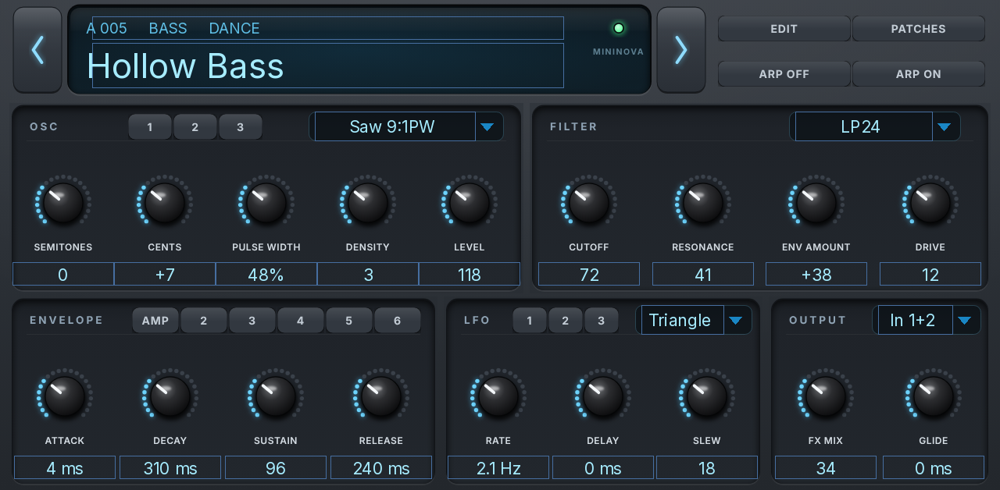

# Nova Editor

An editor and librarian for the **Novation MiniNova**, as a native plugin for Akai MPC OS standalone devices, with
its own MPC screen skin. It also works as a **SysEx librarian for any other synth**: receive, list, export and send
patch dumps back.

MPC does not recognise the MiniNova over USB, so the synth is reached through a small daemon on the device
(`bridge/`), and its sound comes back onto the plugin's own track through a separate addin
([nova-audio](https://github.com/3dthc/mpc-addin-nova-audio)) instead of a second audio track.



## What it does

- **Editing.** Every control maps to a MiniNova CC, NRPN or packed NRPN switch. A control sends only when its value
  changes, and the newest value of each parameter wins, so a fast knob sweep never queues up.
- **Following.** CC and NRPN from the synth move the controls; a program change updates the current patch and pages
  the library to it. Unsaved edits are tracked against the patch as loaded, so navigating away from a genuinely
  modified patch asks once before losing it, and reverting a knob clears that by itself.
- **Librarian.** Banks A-C as last dumped, plus imported `.syx` files, kept on the SD card. A row tap calls the patch
  up on the synth; WRITE puts the chosen patch into a slot; EXPORT writes the banks back out.
- **Other synths.** On linking, a Universal Identity Request names whatever answered. Any synth other than the
  MiniNova is handled as a librarian only: its dumps are captured, named from the data, listed, exported and sent
  back **to the slot they came from**. Nothing guesses which byte selects a slot, so an unknown synth can never have
  the wrong patch overwritten.
- **Sound.** With the addin loaded, the MiniNova plays on the plugin's track: monitored, recorded, mixed and
  resampled like any other MPC instrument. Without it the editor still edits; it just makes no sound of its own.

The plugin has no synthesis engine. A patch dump is a list of settings, not audio — every sound you hear is the
MiniNova's. To keep a patch playable with the synth unplugged, resample it.

## Requirements

- A modded MPC OS standalone device with root shell access (SSH). Stock MPC OS does not offer this.
- A **Novation MiniNova**, connected by USB (for power and MIDI) or by DIN MIDI.
- `bridge/` installed on the device, which shares the synth as an ALSA sequencer port.
- [nova-audio](https://github.com/3dthc/mpc-addin-nova-audio) for sound on the plugin's track. Optional: set
  AUDIO IN to off without it.

## Status per target

| Target | State |
|---|---|
| Gen1 (armv7), MPC OS 3.x | **Runs.** Confirmed on an MPC Live II, MPC OS 3.9.1 and 3.10, with Hakai. |
| Gen1, MPC OS 2.x | **Built, never run.** The skin is written in the 2.x shape and the library is inside 2.x's glibc ceiling, but no 2.x device has loaded it. |
| Gen2 (aarch64), MPC OS 3.x | **Built, never run.** See below. |

**On Gen2:** the plugin, the bridge and the addin all compile and link for aarch64, but none has run on that
hardware, and this one has more to go wrong than an ordinary port. The bridge opens the synth over usbfs and
depends on the MiniNova enumerating at all — on the device it was developed on that needed a kernel quirk added by
hand — and Gen2 is a different SoC with a different kernel. The addin is preloaded into MPC's own process. Treat
the Gen2 build as experimental.

Reports are welcome either way: please say which device, which MPC OS, and what the plugin's connection line shows.

## Install

Three pieces, in this order:

1. **The bridge.** Copy `bridge/` to the device and run its `install.sh` as root over SSH.
2. **The addin** (optional, for sound). See [its repository](https://github.com/3dthc/mpc-addin-nova-audio).
3. **The plugin.** Unzip a release, copy the folder to the device, and run its `install.sh` as root. It stops MPC,
   installs into a Synths folder, backs up `MPC.settings`, registers the plugin and starts MPC again.

Then add **Nova Editor** to a track from the plugin browser.

## On a computer (MPC Desktop, Logic Pro, DAWs)

Each release also has Nova Editor for a computer, with the same sound and touchscreen skin. A project saved on the MPC opens in MPC Desktop (controller mode) with the plugin in place.

### Installing on macOS (Audio Unit and VST3)
**Which zip?**
- **Logic Pro / GarageBand:** `<Name>-<version>-macos-au.zip` (the **Audio Unit**)
- **MPC Desktop / other VST3 hosts:** `<Name>-<version>-macos-vst3.zip` (the **VST3**)

Both work on **Apple Silicon and Intel** Macs. Download one or both.

**1. Leave the zip(s) in your Downloads folder.** Unzipped or not, both are fine.

**2. Open Terminal** (Applications › Utilities › Terminal), **paste this and press Return.** It installs the plugins and clears macOS's *"can't be verified"* block. No password needed.
```
curl -fsSL https://raw.githubusercontent.com/3dthc/mpc-vst-plugins/desktop-vst3-openmpc/tools/install_mac_vst3.sh | bash
```

**3. Check the Audio Unit:** paste this and press Return. **Every plugin should say `PASS`.**
```
curl -fsSL https://raw.githubusercontent.com/3dthc/mpc-vst-plugins/desktop-vst3-openmpc/tools/install_mac_vst3.sh | bash -s -- --check
```

**4. Restart Logic Pro** (it looks for new Audio Units when it starts), **or rescan plugins in MPC Desktop.**

## Build

```sh
tools/layout.py                                     # regenerate the panel layout and artwork
<mpc-vst-plugins>/tools/build_port.sh vst/vst.json all   # both architectures, in the catalog's containers
```

Needs a checkout of [mpc-vst-plugins](https://github.com/sd88me/mpc-vst-plugins) and Docker. `"skin_os": 2` in
`vst/vst.json` writes the skin in the MPC OS 2.x shape, which 3.x reads as well, so one skin covers both.

## Credits and licence

MIT for this repository's own code (`src/`, `bridge/src/`, `tools/`, `vst/`).

| What | Who | Licence |
|---|---|---|
| ALSA headers (`third_party/alsa/`, `bridge/third_party/`), used for types and macros only — libasound is `dlopen`ed at runtime, nothing is linked against it | the ALSA project | LGPL-2.1-or-later |
| Inter (`vst/fonts/Inter.ttf`) | The Inter Project Authors | SIL Open Font License 1.1 (`vst/fonts/OFL.txt`) |
| MPC VST2 wrapper, `mpc_engine_t` interface, build/skin/test tools (not included; cloned separately) | [sd88me/mpc-vst-plugins](https://github.com/sd88me/mpc-vst-plugins) | MIT |
| The audio tap approach | see [nova-audio](https://github.com/3dthc/mpc-addin-nova-audio)'s credits | MIT |

Unofficial and unaffiliated: not made, endorsed or supported by Novation, Focusrite, Akai Professional or inMusic.
"MiniNova" and "Novation" belong to their owners.
